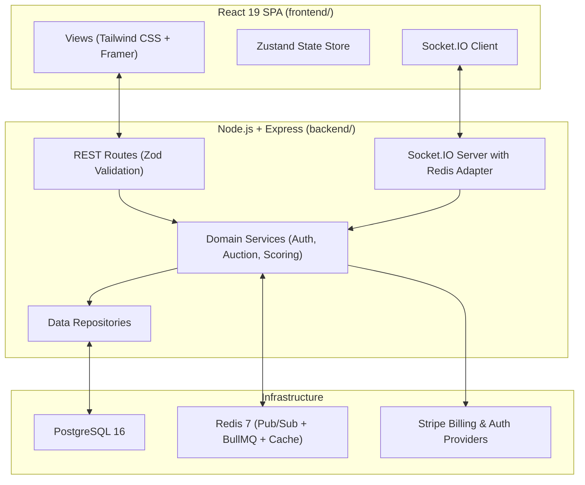

<p align="center">
  
</p>

<h1 align="center">MatchMind</h1>

<p align="center">
  <strong>Real-time, football-first social prediction and live auction draft platform with trading-terminal UX.</strong>
</p>

<p align="center">
  <a href="https://github.com/themanoj-025/MatchMind/actions/workflows/ci.yml"></a>
  <a href="LICENSE"></a>
  <a href="https://github.com/themanoj-025/MatchMind/stargazers"></a>
  <a href="https://github.com/themanoj-025/MatchMind/issues"></a>
  <a href="https://github.com/themanoj-025/MatchMind/pulls"></a>
</p>

---

## Overview

MatchMind combines live sports broadcasting with a fast-paced trading terminal aesthetic. Football enthusiasts compete in real-time player draft auctions under strict financial constraints ($100M salary caps), chat with peers over WebSockets, and climb global fantasy leaderboards.

The stack pairs a React 19 SPA (Zustand + Tailwind CSS) with a TypeScript Node.js backend utilizing Redis pub/sub for cluster-wide Socket.IO state synchronization and BullMQ for background job orchestration.

---

## Table of Contents

- [Key Features](#key-features)
- [Architecture](#architecture)
- [Tech Stack](#tech-stack)
- [Project Structure](#project-structure)
- [Prerequisites](#prerequisites)
- [Quick Start](#quick-start)
- [REST API Reference](#rest-api-reference)
- [WebSocket Events](#websocket-events)
- [Configuration](#configuration)
- [Testing & Quality](#testing--quality)
- [Deployment](#deployment)
- [Roadmap](#roadmap)
- [Contributing](#contributing)
- [Security](#security)
- [License](#license)
- [Support](#support)

---

## Key Features

- **Live Auction Rooms**: Low-latency player bidding with anti-snipe countdown extensions and dynamic algorithmic bid increment curves.
- **Roster & Budget Constraint Guard**: Enforces a strict $100M salary cap across mandatory 15-player squad compositions (2 GK, 5 DEF, 5 MID, 3 FWD), blocking bids that mathematically violate minimum squad requirements.
- **Cluster-Wide WebSocket Synchronization**: Leverages `@socket.io/redis-adapter` so auction events, timer ticks, and room chat seamlessly fan out across multiple backend replicas.
- **Live Leaderboards**: High-throughput room and global ranking computations cached in Redis for fast score retrieval.
- **Resilient Background Execution**: BullMQ handles asynchronous job queues with graceful fallback to synchronous execution when Redis is unavailable.

---

## Architecture



---

## Tech Stack

| Domain | Technology |
| :--- | :--- |
| **Frontend** | React 19, TypeScript, Tailwind CSS, Vite, Zustand |
| **Backend** | Node.js 20+, Express, TypeScript (strict mode), Zod |
| **Realtime** | Socket.IO, `@socket.io/redis-adapter` |
| **Data & Storage** | PostgreSQL 16, Prisma ORM, Redis 7 |
| **Queue** | BullMQ |
| **Testing & CI** | Vitest, Docker Compose, GitHub Actions |

---

## Project Structure

```text
MatchMind/
├── backend/                # Express API, Socket.IO server, domain services
│   ├── src/
│   │   ├── controllers/    # Route controllers
│   │   ├── lib/            # Socket adapters and DB clients
│   │   ├── repositories/   # Database access layer
│   │   ├── services/       # Auction engine, scoring, and auth services
│   │   └── server.ts       # Backend entry point
│   └── tests/              # Backend Vitest suites
├── frontend/               # React 19 single-page application
│   ├── src/
│   │   ├── components/     # UI widgets and trading terminal panels
│   │   ├── pages/          # Draft rooms, match views, leaderboards
│   │   └── store/          # Zustand global state stores
├── packages/               # Shared TypeScript schemas and utilities
├── k8s/                    # Kubernetes manifests and Helm charts
├── docker-compose.yml      # Local development environment (Postgres + Redis)
├── docker-compose.test.yml # Isolated test infrastructure
├── package.json            # Workspace root script orchestration
└── README.md               # Project documentation
```

---

## Prerequisites

- **Node.js**: `>= 20.0`
- **npm**: `>= 10.0`
- **Docker & Docker Compose**: Required for PostgreSQL and Redis services

---

## Quick Start

### 1. Repository Setup

```bash
# Clone the repository
git clone https://github.com/themanoj-025/MatchMind.git
cd MatchMind

# Install workspace dependencies and generate client types
npm run setup

# Setup environment configuration
cp .env.example .env
cp docker-compose.override.yml.example docker-compose.override.yml
```

### 2. Start Full Local Development Stack

```bash
# Spins up Postgres & Redis, runs database migrations, and launches backend + frontend
npm run dev:up
```

*Frontend: http://localhost:5173*  
*Backend API: http://localhost:4000*

### Running Components Individually

```bash
# Terminal 1: Backend API
npm run dev:backend

# Terminal 2: Frontend Web
npm run dev:frontend
```

---

## REST API Reference

| Method | Endpoint | Description | Auth Required |
| :--- | :--- | :--- | :--- |
| `POST` | `/api/v1/auth/register` | Register new manager account | No |
| `POST` | `/api/v1/auth/login` | Authenticate user and issue JWTs | No |
| `GET` | `/api/v1/users/me` | Fetch authenticated user profile | Yes |
| `POST` | `/api/v1/rooms` | Create new draft auction room | Yes |
| `POST` | `/api/v1/rooms/:id/join` | Join auction room with invite code | Yes |
| `POST` | `/api/v1/rooms/:id/ready`| Toggle manager ready state | Yes |
| `GET` | `/api/v1/matches` | List upcoming and active fixtures | Yes |
| `GET` | `/api/v1/leaderboard/rooms/:id` | Fetch specific room standings | Yes |
| `POST` | `/api/v1/stripe/checkout` | Initialize Pro tier subscription | Yes |

---

## WebSocket Events

Real-time auction rooms communicate over Socket.IO:

| Event | Direction | Description |
| :--- | :--- | :--- |
| `bid` | Client → Server | Place bid on currently nominated player |
| `chat:send` | Client → Server | Submit chat message to draft room |
| `chat:message` | Server → Client | Broadcast chat message to room members |
| `auction:update`| Server → Client | State change (new player, timer reset, sold) |
| `room:member_update` | Server → Client | Participant join/leave or ready status change |
| `leaderboard:update` | Server → Client | Match points recalculation update |

---

## Configuration

Core environment variables defined in `.env`:

| Variable | Default | Purpose |
| :--- | :--- | :--- |
| `DATABASE_URL` | `postgresql://...` | PostgreSQL connection string |
| `REDIS_URL` | `redis://localhost:6379` | Redis connection URL |
| `JWT_SECRET` | `""` | Signing secret for access tokens |
| `JWT_REFRESH_SECRET` | `""` | Signing secret for refresh tokens |
| `STRIPE_SECRET_KEY` | `""` | Optional Stripe secret key for Pro billing |
| `ANTHROPIC_API_KEY` | `""` | Optional API key for AI draft recommendations |

---

## Testing & Quality

```bash
# Run linting across workspace
npm run lint

# Run TypeScript typechecks
npm run typecheck

# Run Vitest test suite
npm run test

# Run tests with code coverage
npx vitest run --coverage
```

---

## Deployment

### Containerized Deployment

```bash
# Build production bundles
npm run build

# Start production server
cd backend && npm start
```

Kubernetes deployments are documented with manifests in `k8s/`.

---

## Roadmap

- [x] WebSocket auction draft engine with Redis adapter
- [x] Anti-snipe timer and dynamic bid calculations
- [x] $100M salary cap and 15-man squad constraint engine
- [x] Global and private room leaderboards
- [x] Full TypeScript strict mode architecture
- [ ] Automated k6 load tests for auction concurrency <!-- TODO: Track via GitHub issue -->
- [ ] Dedicated scoring calculation worker extraction <!-- TODO: Track via GitHub issue -->

---

## Contributing

Contributions are welcomed! Please see [CONTRIBUTING.md](CONTRIBUTING.md) for branch management and pull request protocols.

---

## Security

Please report vulnerabilities following the disclosure guidelines in [SECURITY.md](SECURITY.md).

---

## License

This project is licensed under the [MIT License](LICENSE).

---

## Support

- 🐛 **Issue Tracker**: [GitHub Issues](https://github.com/themanoj-025/MatchMind/issues)
- 💡 **Feature Requests**: [GitHub Pull Requests](https://github.com/themanoj-025/MatchMind/pulls)
