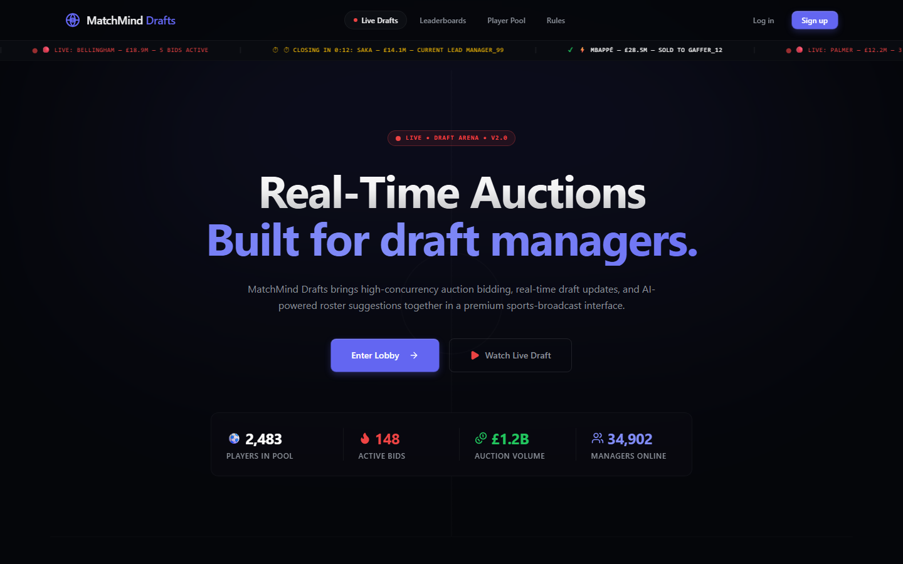
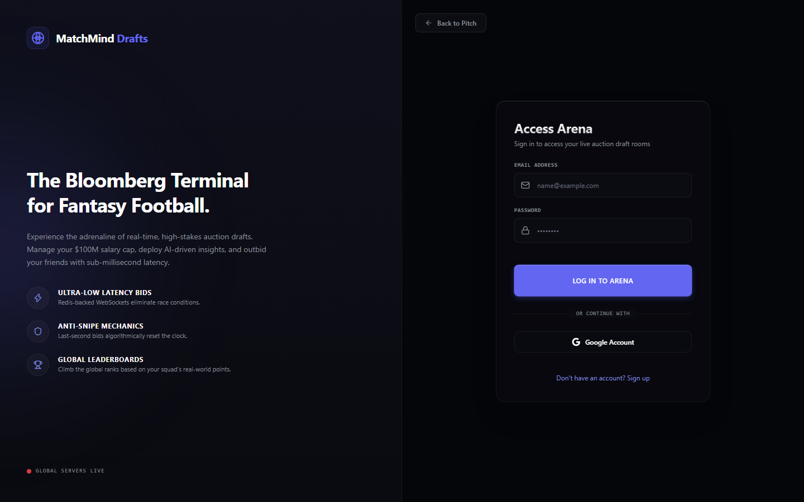
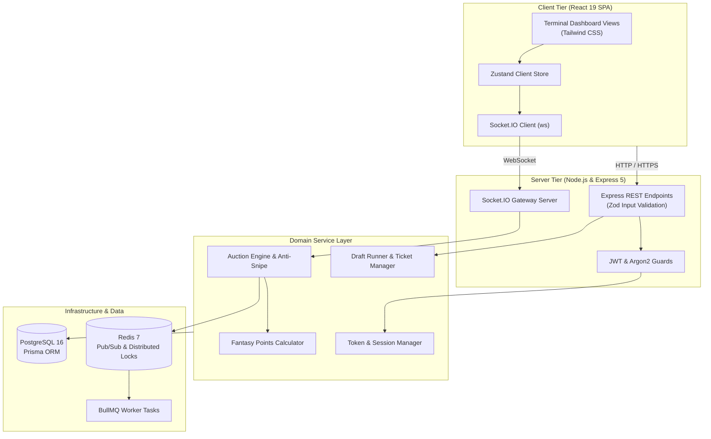

# MatchMind

[](https://github.com/themanoj-025/MatchMind/actions/workflows/ci.yml)
[](./LICENSE)
[](https://nodejs.org/)
[](https://www.typescriptlang.org/)
[](https://react.dev/)
[](backend/src/__tests__/)

Real-time, football-first social prediction and live auction draft platform.
Combines live match tracking with a Bloomberg-style trading terminal aesthetic,
enabling fantasy managers to participate in live player auctions with anti-snipe
timers, WebSocket bid synchronization, and global leaderboard rankings.

---

## Quick Facts

| Dimension           | Details                                                                           |
| ------------------- | --------------------------------------------------------------------------------- |
| **Domain**          | Fantasy Sports, Real-Time Auction Drafts & Social Prediction                      |
| **Frontend**        | React 19 SPA + Vite + Tailwind CSS + Zustand state management                     |
| **Backend**         | Node.js 20+ + Express 5 + Socket.IO 4.8 + Prisma ORM                              |
| **Realtime Engine** | WebSocket bid streams with Redis distributed locks and `@socket.io/redis-adapter` |
| **Background Jobs** | BullMQ task queues backed by Redis for draft ticketing and scoring                |
| **Security & Auth** | Dual JWT + Refresh tokens, Argon2 hashing, Helmet, CSRF defenses, OWASP audited   |
| **Test Coverage**   | 194 collected tests across 64+ Vitest backend suites + Playwright E2E             |
| **License**         | [MIT License](./LICENSE)                                                          |

---

## Table of Contents

- [What It Does](#what-it-does)
- [Screenshots](#screenshots)
- [Key Features](#key-features)
- [Architecture](#architecture)
- [Engineering Audit & Remediation](#engineering-audit--remediation)
- [Tech Stack](#tech-stack)
- [Prerequisites](#prerequisites)
- [Quick Start](#quick-start)
- [Configuration](#configuration)
- [Project Structure](#project-structure)
- [API Reference](#api-reference)
- [WebSocket Events](#websocket-events)
- [Testing](#testing)
- [Limitations](#limitations)
- [Contributing](#contributing)
- [Security](#security)
- [License](#license)

---

## What It Does

Traditional fantasy sports applications often feel static, relying on passive
waiver-wire claims or simple turn-based serpentine drafts. They lack the urgency,
social banter, and tactical thrill of live auctions.

**MatchMind** transforms fantasy drafts into high-frequency auctions:

1. **Live Auction Bidding:** Managers enter synchronized auction rooms to bid on
   players nominated algorithmically or by participants.
2. **Anti-Snipe Countdown:** Bids submitted during the final seconds dynamically
   reset the countdown clock, preventing bot sniping and giving human bidders fair reaction time.
3. **Dynamic Bid Increments:** Required bid deltas scale automatically according
   to current player valuation brackets.
4. **Hard Salary Caps & Roster Rules:** Managers navigate a strict $100M budget
   to assemble a compliant 15-player squad (2 GK, 5 DEF, 5 MID, 3 FWD) with automated budget lockout.
5. **Real-Time Standings:** Integrates match performance metrics into fantasy
   points with instantaneous Redis-cached global leaderboards.

---

## Screenshots

| Landing Page                                         | Authentication                                     |
| ---------------------------------------------------- | -------------------------------------------------- |
|  |  |
| _Live draft room ticker and active leagues_          | _Secure authentication with OAuth support_         |

<!-- TODO[L2-01]: Add live auction room view with active countdown and squad allocation screen -->

> _Live auction terminal with anti-snipe countdown, player card bids, and team budget allocations._

---

## Key Features

- **Distributed Auction Locking:** Redis-backed distributed locks (`ioredis` +
  `async-mutex`) ensure atomic bid registration and prevent double-spend or out-of-order race conditions.
- **Horizontal WebSocket Scaling:** Socket.IO instances synchronize rooms and
  broadcasts across multi-instance clusters via `@socket.io/redis-adapter`.
- **Roster Budget Lockout:** Enforces mathematical budget constraints; bids that
  would leave insufficient funds to fill remaining mandatory roster slots are rejected.
- **AI-Powered Draft Insights:** Optional Anthropic Claude integration generates
  real-time draft advisory hints and squad balance analysis.
- **Resilient Background Processing:** BullMQ orchestrates draft ticket creation,
  auction recovery runs, and periodic leaderboard recalculation without blocking HTTP threads.

---

## Architecture



---

## Engineering Audit & Remediation

MatchMind underwent a structured multi-volume engineering audit covering OWASP
Top 10 vulnerabilities, concurrency edge-cases, and architecture cleanliness:

- **Security Boundaries:** Separated JWT signing secrets (`JWT_SECRET`,
  `JWT_REFRESH_SECRET`, `JWT_RESET_SECRET`) to eliminate cross-token privilege escalation.
- **Data Layer Decoupling:** Replaced raw in-memory JSON state with Prisma ORM
  repositories and PostgreSQL transactions.
- **Circuit Breakers & Retries:** Integrated Opossum circuit breakers on external
  sports APIs (SportRadar) and Stripe webhooks to isolate external outages.

---

## Tech Stack

| Component                | Technology          | Version       | Purpose                                         |
| ------------------------ | ------------------- | ------------- | ----------------------------------------------- |
| **Backend Runtime**      | Node.js             | `>=20.0.0`    | High-concurrency async runtime                  |
| **Server Framework**     | Express             | `5.2.x`       | RESTful API routing and middleware              |
| **Realtime Gateway**     | Socket.IO           | `4.8.x`       | Real-time bidirectional WebSocket rooms         |
| **Frontend Framework**   | React               | `19.x`        | Modern reactive UI architecture                 |
| **Build Tooling**        | Vite                | `8.x`         | High-speed frontend development and bundling    |
| **Styling**              | Tailwind CSS        | `4.x`         | Bloomberg terminal dark aesthetic               |
| **Database & ORM**       | PostgreSQL & Prisma | `16` / `7.10` | Relational persistence and schema migrations    |
| **Cache & Realtime Hub** | Redis & IORedis     | `7` / `6.x`   | Distributed locking, caching, and room adapters |
| **Job Queue**            | BullMQ              | `6.x`         | Background processing and draft recovery        |
| **Validation & Schema**  | Zod                 | `3.x`         | Strict request and socket payload typing        |
| **Testing**              | Vitest & Playwright | Latest        | Unit, integration, and E2E browser test suites  |

---

## Prerequisites

- **Node.js 20+** and **npm**
- **Docker & Docker Compose** (for PostgreSQL and Redis services)
- Optional: **Stripe** test account (for billing flows)
- Optional: **Anthropic API Key** (for draft insights)

---

## Quick Start

### 1. Clone & Set Up Repositories

```bash
git clone https://github.com/themanoj-025/MatchMind.git
cd MatchMind
```

### 2. Start Infrastructure Services

Spin up local PostgreSQL and Redis containers:

```bash
docker compose up -d postgres redis
```

### 3. Configure & Launch Backend

```bash
cd backend
cp .env.example .env
npm install
npx prisma generate
npx prisma db push
npm run dev
```

_Expected output:_

```text
[INFO] Server running on port 4000 in development mode
[INFO] Connected to PostgreSQL via Prisma
[INFO] Redis client connected at redis://localhost:6379
[INFO] Socket.IO server initialized with Redis adapter
```

The REST API will be active at [http://localhost:4000](http://localhost:4000).

### 4. Configure & Launch Frontend

In a separate terminal:

```bash
cd frontend
npm install
npm run dev
```

The terminal interface will load at [http://localhost:5173](http://localhost:5173) (or `http://localhost:3000`).

---

## Configuration

All configuration variables are defined in `backend/.env.example`:

| Variable               | Default                  | Secret? | Description                                     |
| ---------------------- | ------------------------ | ------- | ----------------------------------------------- |
| `PORT`                 | `4000`                   | No      | Express HTTP server port                        |
| `REDIS_URL`            | `redis://localhost:6379` | No      | Redis connection URI for locks and Socket.IO    |
| `JWT_SECRET`           | `""`                     | Yes     | 64-character secret for access tokens           |
| `JWT_REFRESH_SECRET`   | `""`                     | Yes     | 64-character secret for refresh tokens          |
| `JWT_RESET_SECRET`     | `""`                     | Yes     | 64-character secret for password reset tokens   |
| `GOOGLE_CLIENT_ID`     | `""`                     | Yes     | Google OAuth Client ID                          |
| `GOOGLE_CLIENT_SECRET` | `""`                     | Yes     | Google OAuth Client Secret                      |
| `SPORTRADAR_API_KEY`   | `""`                     | Yes     | Live sports fixture and statistics API key      |
| `ANTHROPIC_API_KEY`    | `""`                     | Yes     | Anthropic Claude key for draft hints            |
| `STRIPE_SECRET_KEY`    | `""`                     | Yes     | Stripe secret key for Pro subscription handling |

---

## Project Structure

```text
MatchMind/
├── backend/                    # Node.js + Express + Socket.IO service
│   ├── prisma/                 # Database schema and migration specifications
│   └── src/
│       ├── __tests__/          # Integration and boot verification suites
│       ├── config/             # Environment, schema, and tournament definitions
│       ├── middleware/         # Auth, CSRF, rate-limiting, circuit breakers
│       ├── repositories/       # Prisma database query abstractions
│       ├── routes/             # REST controllers (auth, auction, draft, rooms)
│       ├── services/           # Auction engine, lock manager, fantasy scoring
│       ├── socket/             # WebSocket handlers and room lifecycle
│       └── workers/            # BullMQ background task workers
├── frontend/                   # React 19 + Vite + Tailwind client
│   ├── e2e/                    # Playwright end-to-end specifications
│   ├── public/                 # Static branding and icon assets
│   └── src/                    # UI views, terminal layouts, Zustand stores
├── docs/                       # Architectural audits and screenshot assets
├── tests/                      # Python circuit breaker integration tests
├── docker-compose.yml          # Container configuration for local development
└── README.md
```

---

## API Reference

| Method | Endpoint             | Auth   | Description                                    |
| ------ | -------------------- | ------ | ---------------------------------------------- |
| `POST` | `/api/auth/register` | Public | Create new manager account                     |
| `POST` | `/api/auth/login`    | Public | Authenticate manager and issue token pair      |
| `GET`  | `/api/rooms`         | JWT    | List active public and private draft rooms     |
| `POST` | `/api/rooms`         | JWT    | Create new custom auction room with salary cap |
| `GET`  | `/api/players`       | JWT    | Paginated list of available football players   |
| `GET`  | `/api/leaderboard`   | Public | Ranked global fantasy leaderboard              |
| `GET`  | `/api/health`        | Public | System liveness probe and database check       |

---

## WebSocket Events

Real-time bid synchronization communicates over Socket.IO channels:

| Event                 | Direction        | Payload                                 | Description                                       |
| --------------------- | ---------------- | --------------------------------------- | ------------------------------------------------- |
| `auction:join`        | Client -> Server | `{ roomId }`                            | Join room channel and retrieve current bid state  |
| `auction:bid`         | Client -> Server | `{ roomId, playerId, amount }`          | Submit new bid with distributed lock check        |
| `auction:bid_placed`  | Server -> Client | `{ playerId, amount, bidderId, timer }` | Broadcast accepted bid and reset anti-snipe clock |
| `auction:player_sold` | Server -> Client | `{ playerId, winnerId, finalAmount }`   | Broadcast player allocation and advance queue     |
| `auction:timer_tick`  | Server -> Client | `{ secondsRemaining }`                  | Synchronized countdown clock broadcast            |

---

## Testing

The testing suite contains 194 unit and integration tests written in Vitest
alongside Playwright E2E browser tests:

```bash
# Run backend Vitest suite
cd backend
npm run test:ci

# Run frontend test suite
cd ../frontend
npm test

# Run Playwright E2E tests
npx playwright test
```

All test runs isolate database mutations using test database instances
or temporary mock adapters.

---

## Limitations

- **Single Redis Instance:** In standard configurations, Redis handles locks,
  caching, and Socket.IO pub/sub; production deployments with high volume should
  use Redis Sentinel or a managed Redis Cluster.
- **Event Loop Compute:** Heavy aggregate score calculations are offloaded to
  BullMQ workers to ensure the main Express event loop remains unblocked.
- **Sports Data Mocking:** Without a live SportRadar API subscription, the platform
  uses seeded sample league catalogs and deterministic fixture schedules.

---

## Contributing

Contributions are welcome! Please follow these steps:

1. Fork the repository.
2. Create a feature branch: `git checkout -b feat/my-feature`.
3. Verify formatting and linting: `npm run lint` and `npm run typecheck`.
4. Run test suites: `npm test`.
5. Open a pull request against `main`.

See [CONTRIBUTING.md](./CONTRIBUTING.md) for detailed guidelines.

---

## Security

Please report vulnerabilities privately via GitHub Security Advisories or by
contacting the maintainers. Never commit real API keys or credentials.
See [SECURITY.md](./SECURITY.md) for full policy.

---

## License

This project is licensed under the [MIT License](./LICENSE).
